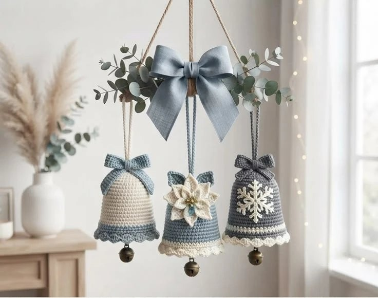
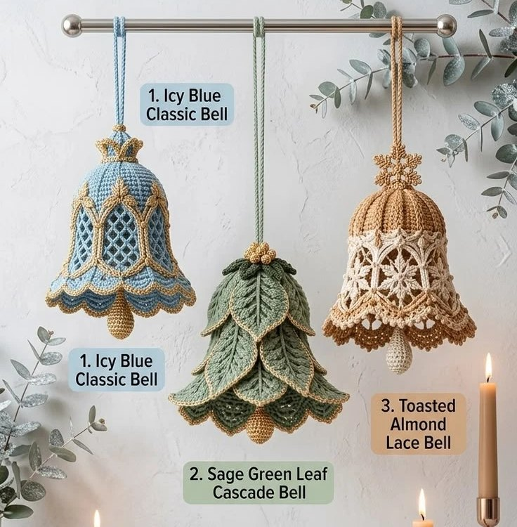
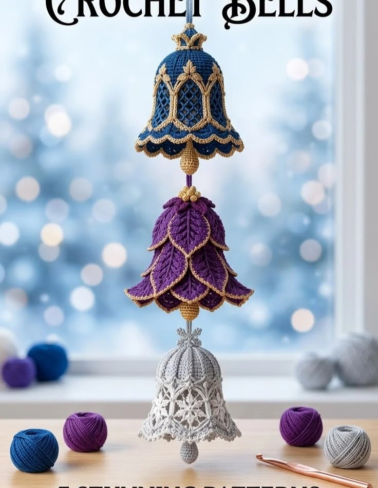
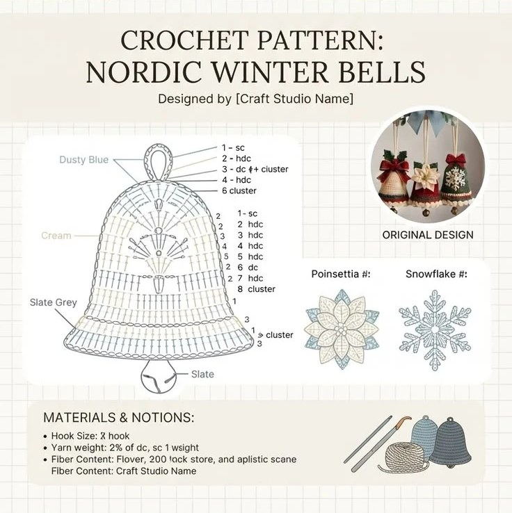

# Campanas nórdicas (y variantes de encaje, hojas y colores joya)

*Campanas nórdicas: crudo y azul, azul con poinsettia, gris con copo de nieve*

*Campana de malla azul hielo, de hojas en cascada verde salvia y de encaje almendra*

*Colores joya: malla azul marino y dorado, hojas moradas y encaje gris plata*

*Esquema de la campana nórdica (los números del diagrama no se leen bien)*

**Nivel:** intermedio (la base) / avanzado (encaje y hojas) · **Tamaño:** ~10-11 cm de alto × 8 cm de ancho con worsted y gancho 3,5 mm; ~8 × 6,5 cm con DK y gancho 3 mm

Una misma campana base en espiral y cuatro formas de decorarla, sacadas de tus fotos:

| Variante | Basada en | Dificultad |
|---|---|---|
| [1. Campana nórdica](#1-campana-nórdica-base) con lazo, flor o copo | *Nordic Winter Bells* | Intermedio |
| [2. Campana de malla](#2-campana-de-malla-con-contorno-dorado) con contorno dorado | *Icy Blue Classic Bell* y la campana azul marino | Avanzado |
| [3. Campana de hojas en cascada](#3-campana-de-hojas-en-cascada) | *Sage Green Leaf Cascade Bell* y la morada | Avanzado |
| [4. Colores y remates](#4-colores-y-remates) | las tres hojas de referencia | |

> Las fotos de referencia son imágenes y no incluyen texto de patrón legible: la hoja *Nordic Winter Bells* tiene un diagrama con números ilegibles y las otras dos no traen ningún esquema (son solo fotos). **Los recuentos de puntos son diseño mío** a partir de la forma de las campanas. No los he tejido: haz primero una campana de prueba.

## Materiales
- Hilo de algodón worsted (o DK para una campana más pequeña): colores según la variante
- Gancho 3,5 mm (3 mm con DK). Teje **apretado** para que la campana mantenga la forma.
- 1 cascabel de latón de 15-20 mm por campana
- Hilo dorado fino (variantes 2 y 3), aguja lanera, marcador de puntos
- Almidón o endurecedor de tela (opcional, para que la campana no se deforme)

---

## 1. Campana nórdica (base)

Se trabaja en **espiral**, sin cerrar las rondas ni rellenar. Los recuentos valen para cualquier hilo.

### Cúpula (sc)
- **Rnd 1:** MR, 6 sc (6)
- **Rnd 2:** inc ×6 (12)
- **Rnd 3:** [sc, inc] ×6 (18)
- **Rnd 4:** [sc ×2, inc] ×6 (24)
- **Rnd 5:** sc en cada punto (24)
- **Rnd 6:** [sc ×3, inc] ×6 (30)
- **Rnd 7:** sc en cada punto (30)
- **Rnd 8:** [sc ×4, inc] ×6 (36)

### Cuerpo (hdc), con el vuelo creciendo
- **Rnd 9:** hdc en cada punto (36)
- **Rnd 10:** [hdc ×5, inc] ×6 (42)
- **Rnd 11:** hdc en cada punto (42)
- **Rnd 12:** [hdc ×6, inc] ×6 (48)
- **Rnd 13:** hdc en cada punto (48)
- **Rnd 14:** [hdc ×7, inc] ×6 (54)
- **Rnd 15:** [hdc ×8, inc] ×6 (60)
- **Rnd 16:** [hdc ×9, inc] ×6 (66)
- **Rnd 17:** [hdc ×10, inc] ×6 (72)
- **Rnd 18:** [hdc ×11, inc] ×6 (78)
- **Rnd 19:** [hdc ×12, inc] ×6 (84)

### Borde en abanico
- **Rnd 20:** [sc, saltar 2 puntos, 5 dc en el siguiente, saltar 2 puntos] ×14. sl st en el 1.er sc. (14 abanicos). Remata.

> Cada abanico gasta 6 puntos: 84 ÷ 6 = 14. Si quieres más o menos vuelo, cambia el total final a otro múltiplo de 6.

### Colores de las tres campanas de la foto
- **Crudo y azul polvo:** Rnd 1-15 en crudo; Rnd 16-20 en azul polvo (banda y abanicos). Lazo azul.
- **Azul y crudo:** todo el cuerpo azul; abanicos de la Rnd 20 en crudo. Poinsettia crema encima.
- **Gris pizarra y crudo:** cuerpo gris pizarra; Rnd 17-19 y abanicos en crudo. Copo de nieve crema encima.

### Cascabel y cordón
1. Ensarta el cascabel en 15 cm de hilo y átalo de modo que cuelgue ~1 cm por debajo del borde.
2. Pasa el otro extremo por el MR de la parte alta y anúdalo por dentro.
3. **Cordón:** 3 cadenetas de 40 puntos, trenzadas; pásalo por el MR y anúdalo por dentro. Para unas campanas colgadas de un aro, haz el cordón de ~30 cm.

### Lazo pequeño (azul o gris)
- **Lazada:** ch 12. hdc en la 3.ª cad. y en cada cadeneta (10). 6 filas de hdc (ch 2 al girar). Une los extremos cortos en anillo con la costura en el centro.
- **Colas (×2):** ch 8. hdc en la 3.ª cad. y en cada cadeneta (6). 6 filas de hdc. Recorta una V en el extremo.
- **Nudo:** ch 5, 3 filas de hdc, enróllalo alrededor del centro y cóselo por detrás.
- Cose el lazo a un lado de la parte alta, junto al cordón.

### Poinsettia para la campana
Usa la [versión B de la poinsettia](../motivos/poinsettia.md#b-mini-poinsettia-de-2-capas-para-colgar-7-cm) en crudo con 3 cuentas doradas, sin hojas ni fieltro, y cósela en el frente.

### Copo de nieve para la campana (sencillo)
- MR, ch 1, 6 sc en el anillo, sl st en el 1.er sc (6).
- Para cada brazo, en un sc del anillo: ch 8. Vuelve por la cadeneta con sl st en cada una desde la 2.ª, y en la 3.ª y la 5.ª desde la punta haz un picot (ch 3, sl st en el mismo punto). Termina con un sl st en el siguiente sc del anillo.
- Haz 6 brazos. Almidona y plancha el copo antes de coserlo, o se queda blando.

---

## 2. Campana de malla con contorno dorado

La campana azul de la foto *Icy Blue* y la azul marino de la hoja de colores joya: cúpula lisa, panel de malla romboidal con pilares y un vuelo de abanicos.

### Cúpula
- **Rnd 1-8:** igual que la base (36).
- **Rnd 9:** [hdc ×5, inc] ×6 (42)
- **Rnd 10:** [hdc ×6, inc] ×6 (48)
- **Rnd 11:** [hdc ×7, inc] ×6 (54)

### Malla (6 repeticiones de 9 puntos: 3 de pilar + 6 de malla)
- **Rnd 12:** [hdc ×3, (dc, ch 1, saltar 1 punto) ×3] ×6. Cierra en espiral.
- **Rnd 13:** [hdc en cada hdc ×3, (ch 1, saltar la dc, dc en el siguiente ch-1) ×3] ×6
- **Rnd 14:** [hdc en cada hdc ×3, (dc en el siguiente ch-1, ch 1, saltar la dc) ×3] ×6

> Regla de la malla: **una dc en cada espacio de ch 1 y un ch 1 sobre cada dc**. Así las ventanas quedan desplazadas y forman rombos.

### Vuelo
- **Rnd 15:** hdc en cada dc y en cada ch-1 y en los pilares (54)
- **Rnd 16:** [hdc ×8, inc] ×6 (60)
- **Rnd 17:** [hdc ×9, inc] ×6 (66)
- **Rnd 18:** [hdc ×10, inc] ×6 (72)
- **Rnd 19:** [sc, saltar 2, 5 dc en el siguiente, saltar 2] ×12 (12 abanicos)

### Contorno dorado
Con hilo dorado fino, haz sl st **superficiales** a lo largo de cada pilar (6 líneas, de la Rnd 11 a la Rnd 15) y bordea cada abanico con una vuelta de sc. Los arcos dorados de la foto salen de unir dos líneas de pilares con sl st superficiales por encima de la malla.

### Acabado
- Pon un forro oscuro dentro (fieltro azul) si quieres que se vea la malla, como en la foto.
- La coronita de la parte alta de la foto: 6 pétalos como los de la poinsettia mini (capa 1) sobre un MR de 6 sc, en dorado, cosida al cordón.
- Badajo: bolita dorada ([bayas](../motivos/bayas.md), versión pequeña) en lugar de cascabel, a la altura del borde.

---

## 3. Campana de hojas en cascada

La campana verde salvia de la foto *Sage Green Leaf Cascade* y la morada: un cuerpo liso cubierto de 3 hileras de hojas solapadas, con borde dorado y un racimo de bolitas doradas arriba.

### Cuerpo
Rnd 1-19 de la base, en verde salvia (o morado), **sin** el borde de abanicos. Remata con una vuelta de sc.

### Hojas (de dos lados, con ch N salen N − 2 puntos por lado)
- **Hoja pequeña (×9):** ch 9. Lado 1: sl st, sc, hdc, dc, hdc, sc, sl st; 3 sc en la punta; lado 2 igual al revés. sl st en la base.
- **Hoja mediana (×12):** ch 11. Lado 1: sl st, sc, hdc, dc ×3, hdc, sc, sl st; 3 sc en la punta; lado 2 igual.
- **Hoja grande (×16):** ch 13. Lado 1: sl st, sc, hdc, dc ×5, hdc, sc, sl st; 3 sc en la punta; lado 2 igual.
- **Nervio:** una línea de sl st superficiales en dorado desde la base hasta la punta (opcional).
- **Borde dorado:** una vuelta de sc en dorado alrededor de cada hoja (opcional).

### Montaje, de arriba abajo
1. **Hilera 1:** 9 hojas pequeñas, bases cosidas sobre la Rnd 9, apuntando hacia abajo.
2. **Hilera 2:** 12 hojas medianas sobre la Rnd 13, entre las de la hilera 1.
3. **Hilera 3:** 16 hojas grandes sobre la Rnd 17, entre las de la hilera 2. Que asomen un poco por debajo del borde.
4. Coloca las hojas de arriba abajo para que cada hilera tape las bases de la anterior.

### Remate
- **Parte alta:** 3 bayas pequeñas doradas ([bayas](../motivos/bayas.md)) cosidas juntas sobre el cordón.
- **Badajo:** una bolita dorada alargada (baya grande en dorado) colgada del centro.

> Los números de hojas son estimaciones para que se solapen un poco. Si tu hilo da hojas más grandes o pequeñas, ajusta las cantidades.

---

## 4. Colores y remates

- **Azul hielo y dorado:** variante 2 con cúpula azul claro y contorno dorado.
- **Verde salvia y dorado:** variante 3.
- **Almendra tostada:** variante 2 con cúpula en BLO (hdc en la lazada trasera en las Rnd 9-11 para formar costillas), malla y vuelo en crudo, y copos de nieve bordados en el hueco de los rombos.
- **Colores joya:** azul marino con dorado, morado con dorado, gris plata con crudo.

---

## Referencias en internet
Los encontró el buscador. **No he podido abrirlos** (la red de esta sesión los bloquea), así que no los he comparado con este patrón:
- [Raffamusa Designs: Christmas Bell Amigurumi (versión gratis, DK, gancho 2,75 mm)](https://raffamusadesigns.com/?p=8567)
- [Furls Crochet: bell ornament gratis](https://www.furlscrochet.com/blogs/amigurumi-crochet-tutorials/free-crochet-ornaments-bell)
- [Nicki's Homemade Crafts: Lacy Bell Crochet Ornament (gratis, con vídeo)](https://www.nickishomemadecrafts.com/?p=46580)
- [Start Crochet: Christmas bell ornament gratis](https://startcrochet.com/crochet-christmas-bell-ornament-crochet-pattern-free/)
- [Ravelry: Bell ornament (gratis, sport, 6,5 × 7 cm)](https://ravelry.com/patterns/library/bell-ornament-8)
- [Hobbii: Christmas Bell Ornament (con hojas de acebo)](https://hobbii.com/christmas-bell-ornament)
- [Ravelry: Christmas Bell Mini, de Grace Robson](https://www.ravelry.com/patterns/library/christmas-bell-mini)

No encontré ningún patrón gratis de campana con hojas en cascada ni con malla romboidal y contorno dorado, así que esas dos variantes son diseño propio.
