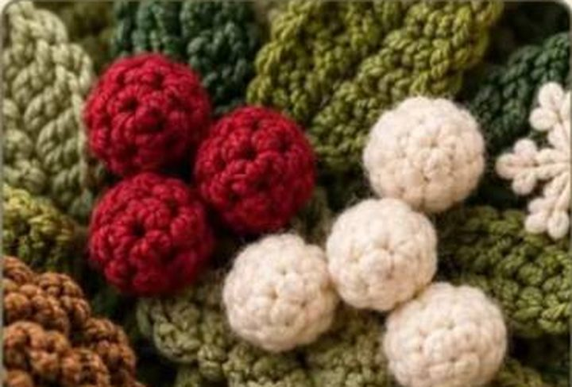

# Bayas (racimos de bolitas)

*Racimos de bayas rojas y crudas (referencia)*

**Nivel:** principiante · **Tamaño:** grande ~3 cm, pequeña ~2 cm (hilo worsted, gancho 3,5 mm)

Bolitas amigurumi en rojo burdeos y crudo. Se agrupan en racimos de 3-5 para la corona.

## Materiales
- Hilo worsted rojo y crudo
- Gancho 3,5 mm (usa 3 mm si quieres que el relleno no se vea)
- Relleno, aguja lanera

## Baya grande (≈3 cm)

- **Rnd 1:** MR, 6 sc (6)
- **Rnd 2:** inc ×6 (12)
- **Rnd 3:** [sc, inc] ×6 (18)
- **Rnd 4-5:** sc en cada punto (18)
- **Rnd 6:** [sc, dec] ×6 (12)
- Rellenar.
- **Rnd 7:** dec ×6 (6)
- Cerrar y rematar.

## Baya pequeña (≈2 cm)

- **Rnd 1:** MR, 6 sc (6)
- **Rnd 2:** inc ×6 (12)
- **Rnd 3-4:** sc en cada punto (12)
- Rellenar.
- **Rnd 5:** dec ×6 (6)
- Cerrar y rematar.

## Racimo
1. Haz 3 bayas (2 grandes + 1 pequeña) o 5 (mezcla de tamaños).
2. Deja una cola de 15 cm en cada una y únelas con la misma cola, anudando cerca de la base.
3. Cose el racimo sobre un par de hojas (ver [hojas](hojas-texturizadas.md)) para que no se vean los nudos.
4. Combina racimos rojos y crudos como en la corona de las fotos.
