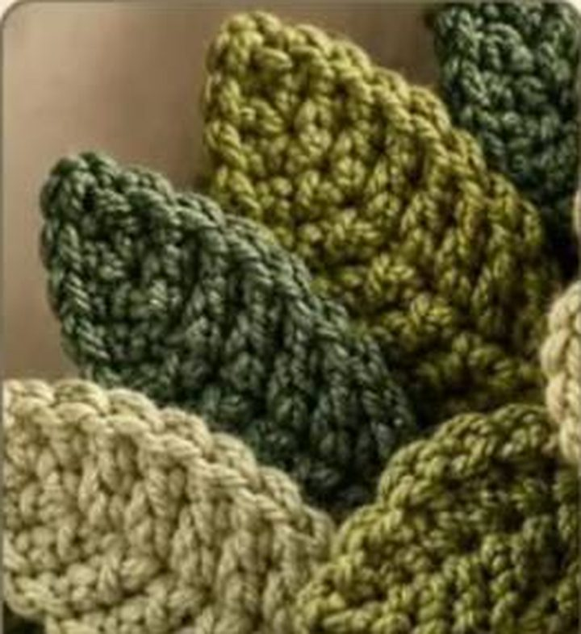

# Hojas texturizadas (capas de hoja)

*Hojas texturizadas en tres verdes (referencia)*

**Nivel:** principiante · **Tamaño:** ~7 × 4 cm con hilo worsted y gancho 3,5 mm

Hoja en forma de rombo alargado, con costillas horizontales (trabajo en BLO). Hazlas en 3 verdes distintos (bosque, oliva, claro) y superpón varias para el efecto "capas" de la corona.

## Materiales
- Hilo worsted/DK en 3 tonos de verde
- Gancho 3,5 mm
- Aguja lanera

## Patrón

Se trabaja en filas, empezando por la base. Al final de cada fila, `ch 1` y girar (el `ch 1` no cuenta como punto).

- **Base:** ch 2.
- **F1:** 3 sc en la 2.ª cadeneta desde el gancho (3)
- **F2:** inc, sc, inc (5)
- **F3:** BLO: sc en cada punto (5)
- **F4:** inc, sc ×3, inc (7)
- **F5:** BLO: sc en cada punto (7)
- **F6:** inc, sc ×5, inc (9)
- **F7-F8:** BLO: sc en cada punto (9)
- **F9:** dec, sc ×5, dec (7)
- **F10:** BLO: sc en cada punto (7)
- **F11:** dec, sc ×3, dec (5)
- **F12:** BLO: sc en cada punto (5)
- **F13:** dec, sc, dec (3)
- **F14:** sc3tog (1)

**Borde y nervio (opcional):** sin cortar, ch 1 y dar una vuelta de sc alrededor de todo el borde (unos 36 pb), y cerrar con sl st. Para marcar el nervio central, haz una línea de sl st en el centro de la hoja desde la base hasta la punta con un hilo un tono más oscuro.

**Rabillo:** al empezar, deja una cola de 10 cm para coser la hoja a la corona.

## Variantes
- **Hoja grande:** repite F7-F8 dos veces más (4 filas en total) y añade `+2` en cada tramo de menguado.
- **Hoja de acebo:** en la vuelta de borde, haz `(sc, ch 2, sl st en la 2.ª cad. desde el gancho, sc)` cada 3 puntos para crear puntas.
