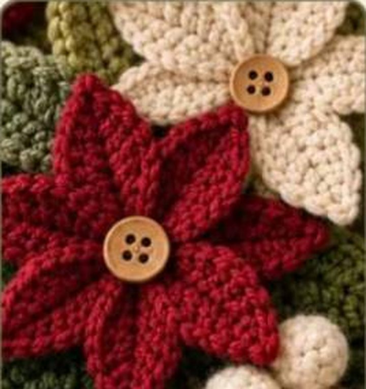
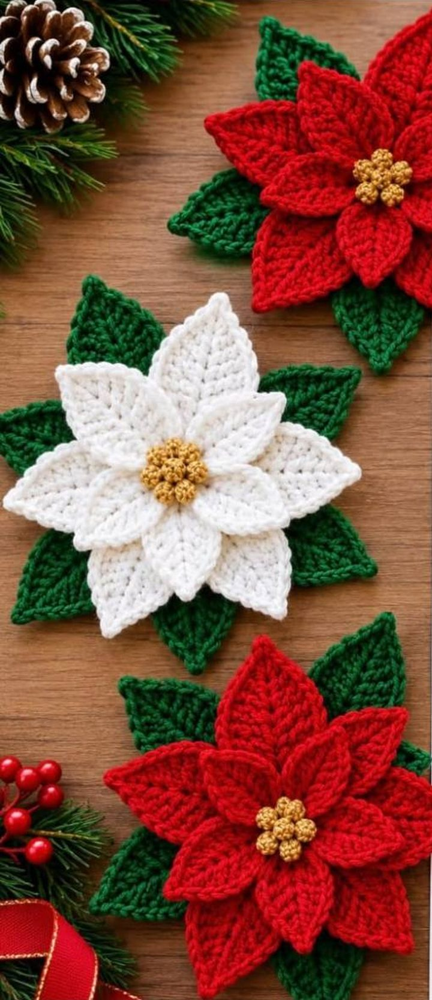
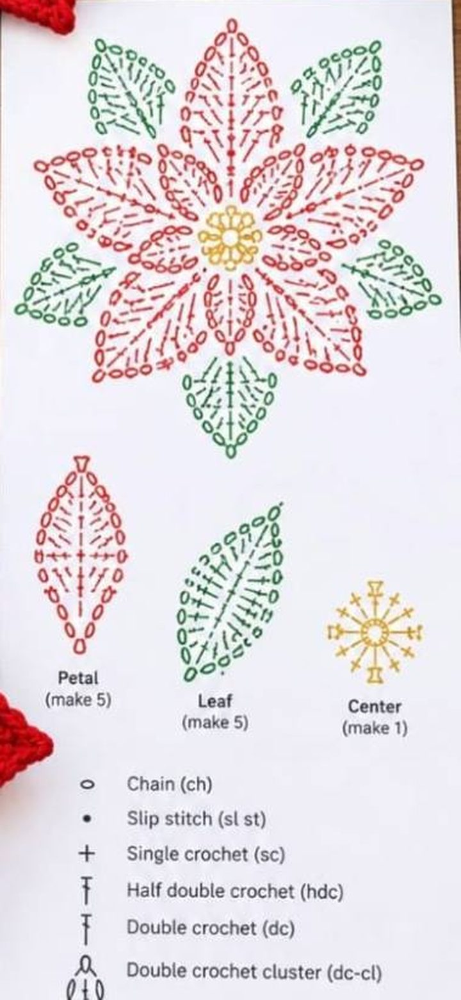
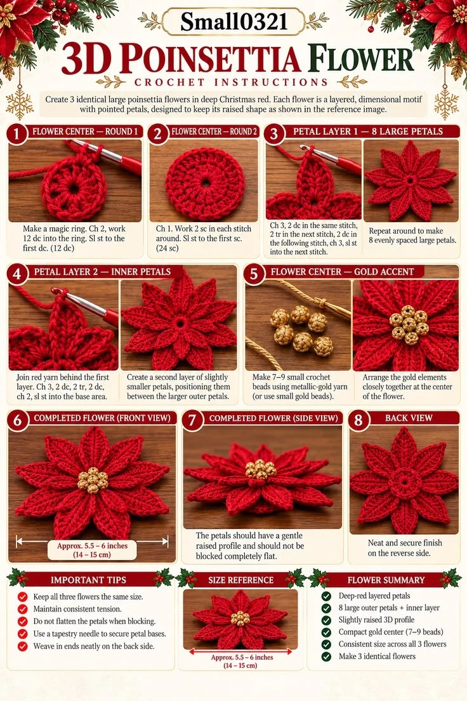
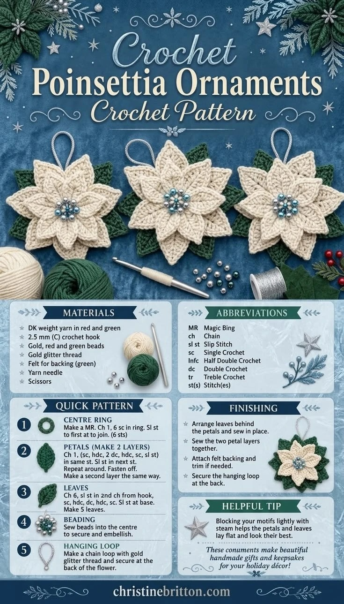
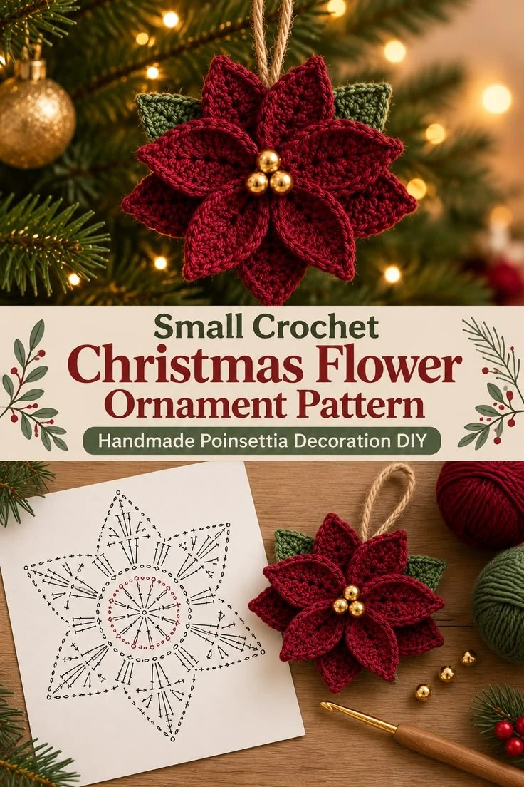

# Poinsettia (flor de Pascua)

*Poinsettia 3D en rojo y crudo con botón de madera (referencia)*

*Poinsettias rojas y crudas con hojas verdes (referencia)*

Tres versiones de la misma flor. Elige según el uso:

| Versión | Tamaño | Para qué |
|---|---|---|
| [A. 3D en capas](#a-poinsettia-3d-en-capas-14-15-cm) | 14-15 cm | Corona de puerta, centro de mesa |
| [B. Mini de 2 capas para colgar](#b-mini-poinsettia-de-2-capas-para-colgar-7-cm) | ~7 cm | Árbol, paquetes, broche, campanas |
| [C. Pétalos sueltos](#c-versión-por-pétalos-sueltos-12-cm) | ~12 cm | Por si prefieres coserlos tú |

Las versiones A y B siguen las hojas de referencia que has enviado (ver [Referencias](#referencias)). La C parte del diagrama de la primera captura.

> **tr** = vareta doble (treble crochet US): 2 lazadas antes de insertar el gancho. Ver [glosario](../../glosario.md).

---

## A. Poinsettia 3D en capas (14-15 cm)

Flor de 2 capas de 8 pétalos apuntados, con relieve suave y centro dorado. **Haz 3 flores idénticas** para la corona (o las que quieras).

### Materiales
- Hilo rojo intenso (o crudo / marfil) y hilo dorado metalizado, o 7-9 cuentas doradas pequeñas
- Gancho: el que te dé un tamaño de 14-15 cm. La hoja de referencia no indica hilo ni gancho; con worsted y 3,5-4 mm debería acercarse, pero haz una flor de prueba.
- Aguja lanera

### Centro
- **Rnd 1:** MR, ch 2, 12 dc en el anillo. sl st en la 1.ª dc (12)
- **Rnd 2:** ch 1, 2 sc en cada punto. sl st en el 1.er sc (24)

### Capa 1: 8 pétalos grandes
Trabaja en las **dos lazadas** de los 24 sc. Cada pétalo ocupa 3 puntos (A, B, C) y se cierra con un sl st en el punto siguiente (D), que es la A del pétalo siguiente.

**Pétalo:** ch 3 · 2 dc en el mismo punto · 2 tr en el siguiente · 2 dc en el siguiente · ch 3 · sl st en el siguiente punto.

Repite 8 veces (8 × 3 = 24 puntos).

### Capa 2: 8 pétalos internos, algo más pequeños
Une el hilo **por detrás de la primera capa**: da la vuelta a la flor y trabaja en las **lazadas traseras (BLO)** de los 24 sc de la Rnd 2. Empieza en el último punto (C) de un pétalo de la capa 1, así cada pétalo nuevo queda centrado **entre** dos pétalos grandes.

**Pétalo:** ch 3 · 2 dc en el mismo punto · 2 tr en el siguiente · 2 dc en el siguiente · ch 2 · sl st en el siguiente punto.

Repite 8 veces. El ch 2 (en vez de ch 3) hace los pétalos algo más cortos.

### Centro dorado
- **7-9 bolitas:** con hilo metalizado dorado, MR, 6 sc; Rnd 2: sc en cada punto (6); Rnd 3: dec ×3 (3). Rellena con un poco de fibra y cierra.
- Alternativa: cuentas doradas de 6-8 mm.
- Cóselas muy juntas en el centro: una en medio y las demás alrededor.

### Acabado
- **No aplanes los pétalos al bloquear:** déjalos con un perfil ligeramente elevado.
- Fija las bases de los pétalos con unas puntadas de aguja lanera.
- Esconde las colas por detrás, que debe quedar limpio (se ve el anillo de 24 sc).

> **Qué cambié respecto a mi primera versión:** había inventado que la capa 1 iba en BLO y la capa 2 en FLO, por delante. La hoja de referencia no dice eso: pide unir la capa 2 «por detrás de la primera capa». Ahora la capa 1 va en las dos lazadas y la capa 2 sale de las lazadas traseras.
> El reparto de los pétalos de la capa 2 (empezar en el punto C) es una deducción mía para que queden entre los grandes; la hoja solo dice «entre los pétalos grandes».

---

## B. Mini poinsettia de 2 capas para colgar (~7 cm)

Versión pequeña: 6 pétalos por capa, 2 capas, hojas verdes detrás, cuentas doradas, fieltro por detrás y lazo para colgar. Mezcla el patrón rápido de christinebritton.com (hoja 2) con el adorno burdeos de la hoja 3 (cordel de yute, 3 cuentas doradas, 2 hojas verdes).

### Materiales
- Hilo DK/sport rojo burdeos (o crudo) y verde
- Gancho 2,5 mm (3 mm si lo teces suelto)
- 3 cuentas doradas de 8 mm, o 7-9 cuentas pequeñas mezcladas
- Hilo dorado con brillo o cordel de yute para el lazo
- Fieltro verde, aguja lanera, tijeras

### Centro
- MR, ch 1, 6 sc en el anillo. sl st en el 1.er sc (6)

### Capa 1: 6 pétalos
Cada pétalo sale de un solo punto:

**Pétalo:** ch 1 · (sc, hdc, 2 dc, hdc, sc, sl st) en el mismo punto · sl st en el siguiente punto.

Repite 6 veces y remata. Trabaja esta capa en el **BLO** del centro.

### Capa 2: 6 pétalos
Une el hilo en el **FLO** de los mismos 6 puntos y repite igual. Quedan apilados sobre la capa 1; tira un poco de cada pétalo hacia un lado para que se vean las dos capas, como en la foto.

> La hoja de referencia solo dice «haz una segunda capa igual». Lo de BLO/FLO es mi propuesta para apilar las capas.

### Hojas (hacer 2 o 5)
Hoja de dos lados, con ch 8:
- ch 8. Desde la 2.ª cad. desde el gancho: sl st, sc, hdc, dc, hdc, sc (6 puntos); 3 sc en la última cad.
- Por el otro lado de la cadeneta: sc, hdc, dc, hdc, sc, sl st (6 puntos); sl st en la cad. de la base. Remata.

> La hoja de christinebritton.com es de un solo lado y dice «ch 6, sl st en la 2.ª cad., sc, hdc, dc, hdc, sc»: con ch 6 solo hay 5 cadenetas desde la 2.ª y la lista tiene 6 puntos, así que no cuadra. Con ch 7 sí sale. La versión de dos lados de arriba es la mía y sí cuadra.

### Acabado
1. Coloca las hojas por detrás de los pétalos y cóselas (2 hojas como en la foto burdeos, 5 como en la hoja azul).
2. Cose las dos capas entre sí por el centro.
3. Cose las cuentas en el centro: 3 en triángulo, o 7-9 en racimo.
4. Corta un trozo de fieltro algo más pequeño que la flor, cóselo por detrás y recorta el sobrante.
5. Lazo para colgar: cadeneta de ~25-30 puntos en hilo dorado, o un lazo de yute, cosido por detrás.
6. Un poco de vapor sobre la flor ayuda a que pétalos y hojas queden planos.

---

## C. Versión por pétalos sueltos (~12 cm)

Pétalos, hojas y centro hechos por separado y cosidos después. Útil para combinar colores. Sale del diagrama «Petal ×5, Leaf ×5, Center ×1» de la primera captura.

*Esquema de la versión por pétalos: Petal ×5, Leaf ×5, Center ×1*

### Pétalo grande (hacer 5)
- ch 12.
- **Lado 1:** desde la 2.ª cad. desde el gancho: sl st, sc, hdc, dc ×4, hdc, sc, sl st (10 pts); 3 sc en la última cad. (punta).
- **Lado 2:** por el otro lado de la cadeneta: sl st, sc, hdc, dc ×4, hdc, sc, sl st (10 pts); sl st en la cadeneta de la base. Rematar con 15 cm de cola.

### Pétalo pequeño (hacer 5)
Igual pero **ch 10** y dc ×2 en lugar de dc ×4 (8 pts por lado).

### Hoja larga (hacer 5, en verde)
Igual pero **ch 14**: `sl st, sc, hdc, dc ×6, hdc, sc, sl st` (12 pts por lado). Marca el nervio con una línea de sl st en verde oscuro.

> Regla general de estas hojas: con ch N salen N − 2 puntos por lado más 3 sc en la punta.

### Centro
- MR, 6 sc; Rnd 2: dc-cl en cada punto (6 bolitas).

### Montaje
1. Hojas en estrella, cosidas por la base.
2. Pétalos grandes intercalados con las hojas.
3. Pétalos pequeños encima de los grandes.
4. Centro (o botones dorados) tapando las bases.
5. Por detrás, broche, lazo o alambre floral.

---

## Referencias

Hojas que me enviaste, guardadas aquí para consultarlas sin conexión. Son de terceros y están solo para uso personal.

*Versión A: 3D Poinsettia Flower, Small0321*

*Versión B: Crochet Poinsettia Ornaments, christinebritton.com*

*Versión B: adorno burdeos con esquema. Es un diagrama de unos 6 pétalos con un centro de 12 dc; no se lee con la nitidez suficiente para transcribirlo punto a punto.*

### Patrones publicados que encajan (sin comprobar)
Los encontré con el buscador, pero **no he podido abrirlos** (la red de esta sesión los bloquea), así que no los he comparado con los míos:
- [Desert Blossom Crafts: poinsettia 3D de 2 capas, gratis](https://desertblossomcrafts.com/crochet-poinsettia-pattern)
- [Kirsten Holloway Designs: adorno poinsettia 3D, gratis, términos US](https://kirstenhollowaydesigns.com/2023/01/3d-poinsettia-flower-ornament-free-crochet-pattern.html)
- [Simply Crochet (Gathered): poinsettia gratis, términos UK](https://www.gathered.how/knitting-and-crochet/crochet/free-christmas-poinsettia-pattern/)
- [All Free Crochet: poinsettia con vídeo y texto](https://allfreecrochet.com/Crochet-Flower-Patterns/How-to-Crochet-a-Poinsettia)
- [Maggie's Crochet: poinsettia fácil](https://www.maggiescrochet.com/pages/poinsettia-free-crochet-pattern)
